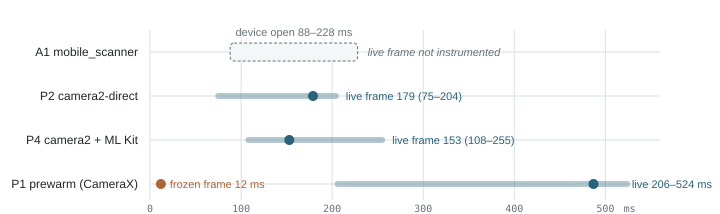
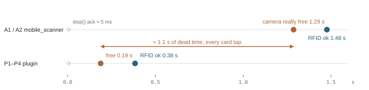
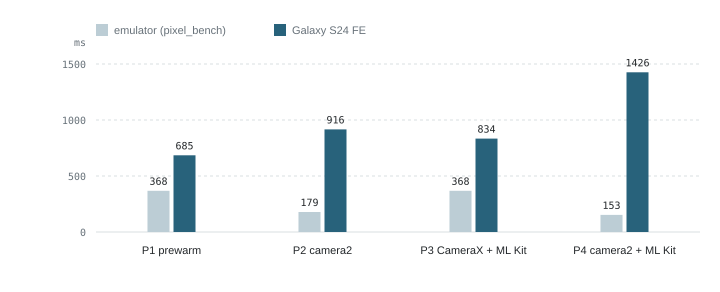

Tapping Scan used to buy a 1–2 second blank: a black screen where the camera should be, just long enough to notice and to mis-tap. Everyone treats this as a fact of phone cameras. After building and benchmarking six implementations of the same screen — first on an emulator, then on a real Galaxy S24 FE — we think the camera was never the slow part, and that the good news is unusual for performance work: the fix is mostly deletion. Delete the per-visit camera setup. Delete the shutdown. Keep one camera texture alive for the whole app session and hand it back only when the NFC reader needs the device. When we measured the pieces, the camera itself opened its door in tens of milliseconds on real hardware — the slowest cold camera open we saw on the phone was 150 ms. The blank second was ours, and it is deletable.

<figure class="hero-figure ix" id="ix-startup" data-ix="startup">
  
  <figcaption><span class="fig-num">Fig 1.</span> <strong>When the picture comes back after tapping Scan.</strong> Replay three startups on the emulator: A1's cold first entry — where the camera does not exist until ≈5.8 s — P4's warm restart (device open at 32 ms, live frame at 153 ms), and P1's prewarmed entry (frozen texture frame at ~15 ms, live by 0.5 s). Press play; hover or focus a marker for the number behind it.</figcaption>
</figure>

## The short version

We have a scanner app with two tabs that matter. One reads barcodes with the camera. One reads RFID cards over NFC. The two can't run at the same time — the arbiter in production already serializes them, and this part was never broken: NFC starts only after the camera is genuinely released.

The complaint was the camera side: first entry into the scan tab after launch, and every return from the RFID tab, showed a blank screen for 1–2 seconds before the picture appeared.

We built two faithful baselines and four redesigns of the same screen, instrumented every stage on a `BENCH` event chain, and ran them through the same tap-driven harness.[^harness] The headline result came from a throwaway experiment: driving the camera directly through `camera2` on the same emulator, with no CameraX anywhere in the process, opened the device in milliseconds and delivered a first frame **0.43 seconds cold**. The CameraX stack in the baseline took **5.8 seconds** to do the same thing at launch. The camera was a rounding error in its own startup cost.

The fix that followed is architectural, not heroic:

- Keep **one persistent texture** for the app's lifetime; never dispose it.
- **Prewarm at launch**, while the user is still on the unrelated search surface, so the first scan entry is a page mount, not a camera start.
- **Release fast** when NFC needs the camera: `unbindAll`, keep the surface, rebind later. Teardown went from ~1.2 s to ~0.2 s.
- When the camera must physically reopen (returning from RFID), rebind to the *same* surface. On the phone that's a 0.7–1.2 s first frame depending on engine, and ~0.19 s until the memory is actually free for NFC.

None of this required new hardware or a new camera engine. With the prewarm in place, the scan tab paints its first frame in **~12 ms on the emulator and 1–20 ms on the phone**. The RFID handoff — the wait before a card can be read after leaving scan — dropped from **~1.45 s to ~0.38 s**.

The surprise at the end: the emulator's ranking of the two camera engines **did not survive contact with the real device**. On the emulator, direct `camera2` beat CameraX by ~190–215 ms on every restart, and we called it the winner. On the S24 FE, the ranking inverted — CameraX delivered the first live frame sooner after an RFID detour (685 and 834 ms, versus 916 and 1426 ms for the `camera2` variants). What transferred was the architecture. What didn't was our confidence in a virtual camera. Both facts are useful, and both are in this write-up.

Two more findings round it out, both written up at the end. First: the manual side-by-side check that closed the campaign caught our own benchmark instrumentation freezing every prototype's preview after the first painted frame — the event logs were green throughout, the picture wasn't. Second: with the numbers now known, we went inside `mobile_scanner` to see why its `stop()` holds the camera for 1.2 s. The answer is lifecycle policy, not technology — and the write-up closes with the three ways to deal with it.

## The blank second

The production app is a Flutter screen with three surfaces: Search, Scan (camera + barcode), RFID (NFC). Camera and NFC cannot share the device, so an arbiter serializes them: before starting an NFC session the app waits for a *real* camera release (the OS availability callback, not the plugin's acknowledgment); after the NFC session ends, scanning may restart. This contract works, and every candidate had to preserve it. The complaint was about the camera side: a blank screen for a beat or two before the picture appeared.

To reproduce it faithfully we built **A1**, a minimal app shaped exactly like production — a bare `mobile_scanner` widget, created when the scan tab mounts and disposed when it unmounts, camera started and stopped with it. **A2** kept the same widget but hoisted the controller and kept the camera alive across the search tab, releasing it only for RFID.

Both were measured with 6 tap-driven trials on the emulator,[^emulator] reading a `BENCH` event chain out of logcat: `tab_tap → scan_page_mounted → start_requested → started → camera_open → first_frame`, with every event time-stamped by the process that emits it.

The cold numbers were exactly the complaint:

- A1, cold: **5.84 s** from tap to camera device open. Warm: 88–228 ms.
- A2, cold: **5.76 s** from tap to the scanner's `start()` future completing. Warm: 30–390 ms.

Here is the cold chain as the device logged it:

```text
BENCH | tab_tap            |
BENCH | scan_page_mounted  |    20.7 ms
BENCH | start_requested    |
BENCH | started            |  5760 ms      <-- the blank second, accounted for
BENCH | camera_open        |  5769 ms
```

For a long time the natural reading was "phone cameras are just slow to start". The next section is the experiment that killed that reading.

## The stack, not the camera

The move that decided the campaign was removing CameraX from the process entirely. **P2** opens the camera through raw `camera2` on a background thread, configures one session with the preview surface, and submits a single repeating preview request. No CameraX, no `mobile_scanner`, no `ProcessCameraProvider`.

Its cold chain on the same emulator: `openCamera` at +21 ms, device opened at +54 ms, session configured at +94 ms, **first frame at +434 ms**. Warm restarts delivered the first frame at a median of 179 ms (75–204 ms).

So the camera hardware floor was under half a second — cold — while the baseline stack took 5.8 seconds to *initialize*, before the camera ever mattered. That gap is the entire story of this project: **almost six seconds of the cold startup was not the camera; it was the software around it.**[^arithmetic]

<figure class="fig-keep">
  <div class="decomp">
    <div class="decomp-row">
      <div class="decomp-head"><span class="decomp-name">A1 — mobile_scanner</span><span class="decomp-note">cold first bind</span><span class="decomp-total">5.76 s</span></div>
      <div class="decomp-bar">
        <div class="decomp-seg is-camera" style="width:7.5%" title="camera-side work: 0.43 s (measured directly through camera2)"></div>
        <div class="decomp-seg is-stack" style="width:92.5%" title="everything else — CameraX and mobile_scanner initialization: ≈ 5.33 s"><span>CameraX + mobile_scanner ≈ 5.33 s</span></div>
      </div>
      <div class="decomp-under"><span class="decomp-flag is-camera">camera-side work: 0.43 s</span></div>
    </div>
    <div class="decomp-row">
      <div class="decomp-head"><span class="decomp-name">P2 — camera2-direct</span><span class="decomp-note">cold, same scale</span><span class="decomp-total">0.43 s</span></div>
      <div class="decomp-bar">
        <div class="decomp-seg is-camera" style="width:7.5%" title="the entire cold start: open, configure, first frame — 0.43 s"></div>
        <div class="decomp-ghost" style="width:92.5%"></div>
      </div>
      <div class="decomp-under"><span class="decomp-flag is-camera">the entire cold start: 0.43 s</span></div>
    </div>
    <div class="decomp-legend">
      <span><i class="sw is-camera"></i>camera-side work: open, configure, first frame</span>
      <span><i class="sw is-stack"></i>everything else: library + framework initialization</span>
    </div>
  </div>
  <figcaption><span class="fig-num">Fig 2.</span> <strong>Where the 5.76 seconds went.</strong> The camera-side work is 0.43 s, measured by opening the same camera directly through <code>camera2</code> on the same emulator. Everything else is stack initialization. The second bar is the whole cold cost of the direct path, at the same scale.</figcaption>
</figure>

We then built the keepers on top of that floor:

- **P1 — prewarm on a persistent texture.** One native `SurfaceTexture` for the entire app session. `warmup()` binds the preview to it; `stop()` calls `unbindAll()` and leaves the texture alive; the next `warmup()` rebinds to the *same* surface. Called at launch, on every scan entry (instant no-op when still warm), and after each RFID detour.
- **P3 — P1 plus ML Kit barcode analysis** on the same warmup: `ImageAnalysis` bound together with `Preview`, YUV at 1280×720, `KEEP_ONLY_LATEST`.
- **P4 — P2 plus ML Kit**: an `ImageReader` on the same `camera2` session, fed to the bundled barcode model.

The first scan entry after launch, fully prewarmed:

<div class="event-strip">
  <span>warmup_already_bound · 0.2 ms</span><span>scan_page_mounted · 11–19 ms</span><span>preview_painted · 12–34 ms</span><span>first live frame · 206–524 ms</span>
</div>

Zero wait to layout, zero wait to paint. One honest caveat: on a *rebind* the texture painted at ~12 ms is the **frozen last frame** — visually camera-like, obviously frozen in motion — and the honest "live preview" timestamp is the first frame from the pipeline.[^frozen]

Analysis turned out to cost nothing structural. P3's first analysis callback tracked its first preview frame within 0–50 ms; P4's analysis and preview frames landed within ~5 ms of each other (medians 147 ms and 153 ms). Once the model is resident and frames are already flowing, decoding capability arrives with the picture.

Two production-grade bugs came out of making analysis real, both now fixed in the reference apps:

- **R8 strips ML Kit's component registrars in release builds.** The symptom is a startup `NullPointerException` deep inside barcode client creation; the fix is keep rules for `ComponentRegistrar` implementations.[^r8]
- **A raw `ImageReader` plus asynchronous ML Kit will die under load** unless frames are gated while a scan is in flight: both buffers held when the next frame arrives is a process death, not an exception you can catch later.[^imagereader] CameraX handles this internally; a `camera2` pipeline must do it explicitly.

The emulator's final ranking, after all six variants:

| Candidate | Engine | First live frame (rebind, median) | Cold (launch) | Teardown |
| --- | --- | ---: | ---: | ---: |
| A1 vanilla | mobile_scanner / CameraX | 88–228 ms to open | 5.84 s | 1.2–1.35 s |
| A2 warm | mobile_scanner / CameraX | 49–390 ms to open | 5.76 s | 1.15–1.27 s |
| P1 | CameraX preview | 368 ms | 0.43 s prewarmable[^p1cold] | 168–521 ms |
| P3 | CameraX + ML Kit | 368 ms | prewarmed | 166–550 ms |
| P2 | camera2-direct | 179 ms | 0.43 s | 99–219 ms |
| **P4** | camera2-direct + ML Kit | **153 ms** | **0.43 s** | 61–228 ms |

P4 won the emulator: fastest restart, fastest cold start, analysis included for free, arbiter contract untouched. That conclusion lasted until the first real phone.

## One camera, two jobs

Everything above is about getting the camera *on*. The second half of the screen's life is handing it *off* — every time the user leaves Scan for RFID, the camera must actually release before the NFC session may start. The arbiter enforces this correctly. The interesting question was what "release" costs.

It costs the baseline app a full second. mobile_scanner's own `stop()` acknowledgment comes back in **3–84 ms** — and it is premature. The real release, observed through the OS camera-availability callback, lands **1.15–1.35 s** after leaving the tab. Only after that callback does the arbiter clear the camera and let RFID start. If you trust the plugin's ack instead of the OS callback, you get a corrupted NFC burst (or a failed one, when the driver wins the race).

The plugin candidates released in **61–228 ms** on the emulator and **160–220 ms** on the phone, because `unbindAll` + a surviving surface is much less work than a full scanner shutdown: no executor teardown, no texture disposal, nothing to recreate later.

<figure class="ix" id="ix-arbiter" data-ix="arbiter">
  
  <figcaption><span class="fig-num">Fig 3.</span> <strong>Leaving Scan for RFID.</strong> Both rows are real event chains: tap the RFID tab, then watch when the camera is genuinely free (orange band) and when the NFC session starts. Press play to race them: the old path spends ≈1.1 s of dead time waiting for the camera to let go; the plugin path spends ~0.19 s.</figcaption>
</figure>

The measurable user-facing result: with the plugin path, RFID is live **~0.38 s** after the user taps the RFID tab, instead of ~1.45–1.5 s. On a card tap that reads as "switch, present the card, done" with no dead zone in between — and it is the same arbiter contract as before, just with a cheaper release behind it.

## Real hardware rewrites the ranking

We built the six apps as arm64 release APKs and installed them on a Galaxy S24 FE (SM-S721B, Android 16) connected over adb,[^phone] then ran the same tap-driven harness against the real camera, real NFC hardware, and a real display. The first results demolished a central assumption from the emulator: **none of the emulator's absolute cold numbers transferred.**

Real-device cold behavior, first scan entry with a fresh process:

- A1: camera device open in **37–74 ms**.
- A2: scanner `started` in **15–67 ms**.
- P3: camera bound, session up, first frame — **906 ms**, of which the camera device itself was 150 ms.
- P4: device open at 65 ms, but session configuration took 741 ms and the first frame 1.48 s — the same slow-configure behavior its rebinds showed.

The emulator's 5.7 s CameraX initialization penalty simply does not exist on a phone with a working GPU and a real camera HAL. On this device, cold camera opens ranged from 32 ms to 150 ms across the six apps — most under 75 ms, and the 150 ms worst case (P3's CameraX bind) is still an eighth of a second. An emulator is a fine place to learn event *order* and to find structural bugs; it is a bad place to learn absolute *time* — and, as the rebind numbers next show, sometimes a bad place to learn ranking at all.

Returning from an RFID detour (first live frame after rebinding), medians from 5–6 cycles per app, emulator versus phone:

<figure class="ix" id="ix-ranking" data-ix="ranking">
  
  <figcaption><span class="fig-num">Fig 4.</span> <strong>The ranking inverted on real hardware.</strong> First live frame after returning from RFID, medians. Toggle between the two environments and watch the bars swap: the emulator said camera2-direct wins (P4, P2 ahead of P1, P3); the phone says the opposite, with P4 — the emulator champion — slowest of the four. P4's gap comes from a bimodal session configure step on this device (~340 ms vs ~730 ms), worth more runs to characterize.</figcaption>
</figure>

The phone-side table behind that chart, plus the handoff numbers from the previous section:

| App | Engine | First live frame (rebind, median) | Camera released | RFID ok after tap |
| --- | --- | ---: | ---: | ---: |
| A1 | mobile_scanner | not instrumented | 1287 ms | 1477 ms |
| A2 | mobile_scanner | not instrumented | 1258 ms | 1447 ms |
| P1 | CameraX preview | **685 ms** | 184 ms | 374 ms |
| P2 | camera2-direct | 916 ms | 160 ms | 356 ms |
| P3 | CameraX + ML Kit | 834 ms | 194 ms | 394 ms |
| P4 | camera2-direct + ML Kit | 1426 ms | 188 ms | 384 ms |

What we thought, versus what the phone says:

<div class="fig-compare">
  <div class="fig-panel">
    <h4>What the emulator said</h4>
    <p>The camera2-direct engine is the fastest way to get frames (P4: 153 ms rebinds, 0.43 s cold). CameraX initialization is a five-second cliff. Port the camera2 pipeline to production; CameraX variants are fallbacks.</p>
  </div>
  <div class="fig-panel">
    <h4>What the phone says</h4>
    <p>Generic cold start is fast for everyone (20–75 ms camera open; prewarmed entry 1–20 ms). On rebinds after NFC, CameraX's warm pipeline produces a live frame sooner than a fresh camera2 session — and the winner depends on a vendor HAL detail neither of us could have predicted from the emulator. Port the architecture, re-rank the engines per device.</p>
  </div>
</div>

The verdict chips for what transferred between environments:

<div class="verdict-chips">
  <span>persistent texture: transferred</span>
  <span>prewarm on entry: 1–20 ms</span>
  <span>fast release: ~0.19 s</span>
  <span class="is-negative">engine ranking: did not transfer</span>
</div>

Two caveats on the phone numbers, since they decide the port: 5–6 cycles per app in one session each, one device[^caveats] — and the real production 1–2 s blank never fully reproduced in a minimal app, because the camera-side pieces we can measure on this phone are all in the tens of milliseconds. The honest synthesis is that a faithful minimal app measured none of the seconds; the architecture we found removes every wait we *can* create — cold stack init, per-visit setup, slow teardown, first-frame latency — and there is no remaining candidate in our decomposition to explain a second and a half. If production still sees a blank second after this port, the next suspects are above the camera: route transition, widget build, and the scanner's first-frame display path. Those are the natural next benchmarks.

## The freeze the tables couldn't see

Every number in this write-up comes from event logs, and the event logs were green for every trial we ran — including the trials of four prototypes whose preview was, in fact, frozen. The catch came from doing what no benchmark did: using the apps by hand, side by side, on the phone. P1 through P4 all showed a picture the instant the scan tab opened — and then the picture didn't move.

The cause was our own instrumentation. Each prototype logged `first_frame` from the Flutter texture's `SurfaceTexture.OnFrameAvailableListener`[^listener] — and that listener is a single slot, with Flutter's `TextureRegistry` already using it to tell the engine "a new frame arrived, schedule a repaint". Our callback silently replaced it. The camera kept streaming; the engine was never told, so the texture painted whenever the tab switch happened to schedule a frame, and then stood still. An instant, frozen picture — and timing tables that looked perfect.

The fix was to stop measuring from inside the thing being measured: `first_frame` now comes from the camera pipeline's own capture callback (`onCaptureStarted`, wired through `Camera2Interop` for the CameraX apps), and the engine keeps its listener. Verified by hand, then by screenshots a second apart that now differ: all four apps stay live through launch and through a full RFID round-trip. The old lesson holds: instrumentation that mutates the measured system lies, and no timing table will ever notice a still image.

## So is mobile_scanner the problem?

No — the camera, CameraX, and ML Kit are all fine inside it. The slow part is the plugin's lifecycle policy: it is built for "mount a scanner, scan, unmount", and this product is a hot tab with an NFC handoff.

- **Every `start()` builds everything.** A fresh texture, a fresh ML Kit scanner, a preview plus a 1920×1080 analysis stream, then a lifecycle bind — nothing reused between visits. (Our own P3 requests 1280×720.)
- **Every `stop()` destroys everything.** One `releaseCamera()` unbinds the camera, then immediately destroys the surface, closes the scanner, and shuts down the analysis executor. The `stop()` future resolves in **3–84 ms**; the OS reports the camera actually free **1.2–1.3 s** after the tab tap, tightly across trials — the tight repeatability says teardown mechanics, not decoder variance. Our path — `unbindAll`, keep the surface — is free in **0.16–0.22 s** on the same phone, same HAL. P1 and P3 run CameraX too; the difference is lifecycle policy, not the camera engine.
- **The promise answers the wrong question.** `stop()` resolving means "the Dart call finished", not "the camera is free". Gating NFC on it corrupts the session, so the arbiter must read the OS availability callback either way. And the plugin's source carries its own evidence that seamless resume isn't there yet: a commented-out `resumeCamera()` with `TODO: resume here for seamless transition`.

<figure class="fig-keep">
  <div class="decomp">
    <div class="decomp-row">
      <div class="decomp-head"><span class="decomp-name">A1 / A2 — mobile_scanner</span><span class="decomp-note">stop() ack: 3–84 ms</span><span class="decomp-total">camera free at 1.29 s</span></div>
      <div class="decomp-bar">
        <div class="decomp-seg is-camera" style="width:3.6%" title="stop() future resolves in 3–84 ms"></div>
        <div class="decomp-seg is-wait" style="width:88.3%" title="camera still held — the OS has not reported a release"></div>
        <div class="decomp-ghost" style="width:8.1%"></div>
      </div>
      <div class="decomp-under"><span class="decomp-flag is-wait">the OS reports the camera free only at 1.29 s</span></div>
    </div>
    <div class="decomp-row">
      <div class="decomp-head"><span class="decomp-name">P1–P4 — plugin</span><span class="decomp-note">stop() ack: ~5 ms</span><span class="decomp-total">camera free at 0.19 s</span></div>
      <div class="decomp-bar">
        <div class="decomp-seg is-camera" style="width:0.4%" title="stop() ack — 3–6 ms"></div>
        <div class="decomp-seg is-wait" style="width:13.1%" title="unbind plus device close — 160–220 ms"></div>
        <div class="decomp-ghost" style="width:86.5%"></div>
      </div>
      <div class="decomp-under"><span class="decomp-flag">the same ack, 1.1 s earlier in reality</span></div>
    </div>
    <div class="decomp-legend">
      <span><i class="sw is-camera"></i>stop() future resolves</span>
      <span><i class="sw is-wait"></i>camera still held — dead time</span>
    </div>
  </div>
  <figcaption><span class="fig-num">Fig 5.</span> <strong>The <code>stop()</code> contract, drawn to scale (1.4 s).</strong> In both stacks the promise resolves in milliseconds; what differs is when the camera is actually free — 1.29 s for the plugin, 0.19 s for ours. The NFC session is gated on the OS release callback in both cases; the plugin's 1.1 s of extra dead time is the handoff cost this campaign started from.</figcaption>
</figure>

### The bug, line by line

Past the latency, there is a correctness problem in the same function. This is the entire teardown, as shipped in `mobile_scanner` v7.4.2:

```kotlin
private fun releaseCamera() {
    // ...
    cameraProvider?.unbindAll()          // camera teardown starts — and is async
    imageAnalysis = null

    surfaceProducer?.release()           // the preview surface is destroyed
    surfaceProducer = null

    scanner?.close()                     // the ML Kit scanner is closed
    scanner = null

    analysisExecutor.shutdown()          // the analyzer's executor stops
    analysisExecutor = Executors.newSingleThreadExecutor()
}
```

Every resource the camera close still depends on — the surface its preview is streaming to, the executor its analyzer posts to — is destroyed immediately after `unbindAll()` *starts* the close, not after it finishes. And the method channel answers right after `stop()` returns: `result.success(null)`, milliseconds later. On the phone, the Dart `stop()` future resolves in **4–11 ms** while the OS reports the camera actually available at **1.2–1.3 s** — tightly, across every trial.

The differential isolates the cost: P1 and P3 call the same `unbindAll()`, but keep the surface and keep their executor alive — the camera is free in **0.16–0.22 s**. Everything the plugin does after `unbindAll()` is extra work that races the in-flight close. Which of the three lines costs what is the natural next experiment; a fork can toggle them one at a time.

Why this is a bug and not merely slow: `await controller.stop()` is the public API's only completion signal, and it is premature by almost the entire teardown. Code that trusts it — open the NFC reader, open another camera, release the phone — runs while the camera's HAL client is still live. With NFC sharing the antenna, that doesn't just cost time: on some devices, starting the reader during camera teardown has been observed to wedge the NFC stack until reboot. Our arbiter was written around exactly this mismatch, and it's the reason the fast paths above gate RFID on the OS callback, not on the plugin's promise.

The state bookkeeping is broken in the same neighborhood. `releaseCamera()` clears `imageAnalysis` but never nulls `camera` or `preview` — and `isStopped()` is defined as `camera == null && preview == null`. After the first successful start it is false forever, so `stop()`'s own "already stopped" guard, `pause()`'s guard, and `dispose()`'s early return are dead code after the first bind. The handler even catches `AlreadyStopped` and reports success, so no Dart caller ever learns the difference. Treat every state predicate in this plugin as advisory; subscribe to the OS for the truth.

A companion package can't paper over this. Flutter plugins have no interception point, the Dart controller exposes no prewarm or hold, and the public API's ceiling is what A2 already does: keep the controller alive so entries stay fast — while `stop()` still costs its 1.2 s, which is exactly why A2 can't survive an RFID detour. Replacing those native classes is a fork, however it's packaged. The honest options:

1. **Fork lightly.** Keep the surface on `stop`, defer the scanner and executor teardown until the OS confirms the release, emit a true `cameraReleased` event, add prewarm and re-attach. It's a small diff, shippable as a git dependency; the ongoing cost is merging upstream releases.
2. **Upstream the same patch.** The TODO in their source says they want seamless transitions; "release in 0.19 s instead of 1.29 s, with numbers" is the kind of PR that gets merged — and then there is no fork at all.
3. **Own the lifecycle.** The P3 shape: ~300 lines of plugin on CameraX + ML Kit — the same first-party stacks `mobile_scanner` wraps internally. You keep the ecosystem and replace only the lifecycle. And if it grows into a general hot-tab package, it's the natural home for the other half of this product: a reader start that gates itself on the real camera release — a primitive no NFC library ships.

The porting recommendation, in one line: **P1 is the fastest thing we built, and P3 is the fastest one that can actually scan.** Take the P4 skeleton — the plugin, the persistent texture, the arbiter handoff, the busy-gated analyzer — and bind it to a CameraX engine (P3's shape) if scanning must survive an RFID detour on this device; keep the camera2 flavor on fast-cold-start devices where its rebind is competitive. The structure is the durable artifact; the engine is a tunable.

One product decision is still open: prewarming holds the camera open while the user is on the search tab, which means the camera privacy indicator is lit as soon as the app launches.[^led] Options range from "prewarm always" to "prewarm on first scan entry, once per session" to "prewarm only while the previous tab was scan". The measured cost of skipping launch prewarm is one cold bind (0.4–0.9 s on this phone) paid once; every later entry stays warm. We later went back and priced the states *between* "streaming" and "off" — the follow-up is [Warm, Not Awake](../warm-not-awake/): a session parked with `stopRepeating` resumes in 266 ms, keeps the indicator dark, and costs half the streaming power.

Six APKs are on the test phone, side by side, for anyone who wants to feel the difference rather than read the tables. The camera was never slow. The blank second was ours — and it is gone.

## The data

Every number in this entry comes from the raw `BENCH` logs, and the logs ship with the site. The [dataset browser](../data/) lets you pick an environment, an app, and any of the 144 recorded cycles and see that cycle's full stage timeline — the same recording the tables above were built from. A few entry points:

- The release gap in one picture: [phone · A1, an RFID cycle](../data/?env=phone&app=a1_vanilla&cycle=1) next to [phone · P3, the same cycle shape](../data/?env=phone&app=p3_mlkit&cycle=1) — 1.22 s versus 0.22 s until the OS frees the camera.
- The rebind after NFC: [phone · P3, cycle 2](../data/?env=phone&app=p3_mlkit&cycle=2).
- The emulator's 5.8-second cold start: [emulator · A2, cycle 0](../data/?env=emulator&app=a2_warm&cycle=0).

Each app folder holds the harness output verbatim: `<app>.stages.json` (one object per cycle, stage → microseconds since the tap), `<app>.events.json` (the timestamped log lines the parser consumed), `<app>.summary.json` (the harness aggregate), and, for the vanilla baseline on the emulator, `<app>.rows.json` (the host-side screen-visibility sample behind the "black screen" claims). Nothing is smoothed or excluded; cycles that misfired are in the files.

If you would rather re-run than re-read: the tap-driven harness and the six app implementations are not public yet; the logs they produced are, and the [dataset browser](../data/) is the place to start.

## Sources

The benchmark targets shipping code, so the primary sources are the exact versions the phone ran.

- **mobile_scanner v7.4.2.** The teardown dissected above is [`releaseCamera()`](https://github.com/juliansteenbakker/mobile_scanner/blob/v7.4.2/android/src/main/kotlin/dev/steenbakker/mobile_scanner/MobileScanner.kt#L635-L662); the `// TODO: resume here for seamless transition` sits in the [start/resume path](https://github.com/juliansteenbakker/mobile_scanner/blob/v7.4.2/android/src/main/kotlin/dev/steenbakker/mobile_scanner/MobileScanner.kt#L417-L441); the premature ack is the [stop handler](https://github.com/juliansteenbakker/mobile_scanner/blob/v7.4.2/android/src/main/kotlin/dev/steenbakker/mobile_scanner/MobileScannerHandler.kt#L273-L281) in `MobileScannerHandler.kt`. Published build: [pub.dev](https://pub.dev/packages/mobile_scanner/versions/7.4.2).
- **Flutter engine textures.** [`TextureRegistry`](https://api.flutter.dev/javadoc/io/flutter/view/TextureRegistry.html) and its `SurfaceProducer`, plus the widget-side [`Texture`](https://api.flutter.dev/flutter/widgets/Texture-class.html): the persistent-texture design leans directly on both.
- **Android camera platform.** [`CameraManager.AvailabilityCallback`](https://developer.android.com/reference/android/hardware/camera2/CameraManager.AvailabilityCallback) is what our arbiter gates the NFC start on; the engine comparison rests on [CameraX](https://developer.android.com/media/camera/camerax), [`Camera2Interop`](https://developer.android.com/reference/androidx/camera/camera2/interop/Camera2Interop), and [`ImageAnalysis`](https://developer.android.com/reference/androidx/camera/core/ImageAnalysis). The freeze fix logs first frames from [`CaptureCallback`](https://developer.android.com/reference/android/hardware/camera2/CameraCaptureSession.CaptureCallback) — `onCaptureStarted` — and the reader side uses the NFC [reader mode](https://developer.android.com/develop/connectivity/nfc/nfc).
- **ML Kit barcode scanning**, the analyzer in every P app: [barcode scanning for Android](https://developers.google.com/ml-kit/vision/barcode-scanning/android).

[^harness]: The harness (`harness/bench.py`) drives the UI with adb taps, keeps the display awake (`svc power stayon` + wakeup), force-stops every benchmark sibling before a run, asserts that window focus is the target package, and then parses the `BENCH` logcat chain into per-trial stages. Six trials per app per environment; each trial taps through scan → RFID → search with fixed dwell times.
[^emulator]: `pixel_bench` AVD: android-35, x86_64, SwiftShader software GPU, virtualscene camera. Treat its timings as rank-and-order evidence, not wall-clock predictions — the next two sections are about exactly why.
[^arithmetic]: The 5.33 s attributed to the stack is 5.76 s (A2's cold `started`) minus 0.43 s (P2's complete cold camera2 chain). It is a subtraction between two apps' measurements, not direct instrumentation of CameraX internals; the order of magnitude is the claim, not the digit.
[^frozen]: On a rebind, `preview_painted` fires at ~12 ms because the persistent texture immediately repaints its last frame — genuinely useful (the pane is never black), but not "live". The honest live-preview timestamp is the frame callback from the camera pipeline itself.
[^listener]: `SurfaceTexture` has exactly one frame-available listener, and Flutter's `TextureRegistry` is already using it to schedule engine repaints. Our bench callback replaced it, so the engine stopped being told about new frames. The fix: log `first_frame` from the camera's own capture callback (`onCaptureStarted`, via `Camera2Interop` for the CameraX apps) and leave the texture's listener alone.
[^r8]: Flutter release builds shrink by default and ML Kit discovers its components reflectively. The symptom chain: `NoSuchMethodException` on registrar construction, then `MlKitContext` never initializes, then barcode-client creation null-pointers the activity at startup. Fix: keep rules for `ComponentRegistrar` implementations (`proguard-rules.pro` in the reference apps).
[^imagereader]: `ImageReader` with `maxImages=2` plus asynchronous analysis means the next frame can arrive while both buffers are still held: `IllegalStateException: maxImages (2) has already been acquired`, uncaught, process death mid-session. The reference pipeline drops incoming frames while a scan is in flight and runs with `maxImages=3`. CameraX's `ImageAnalysis` handles this internally; a raw `camera2` pipeline must do it explicitly.
[^p1cold]: The 0.43 s cell for P1/P2-class paths is the camera-side cost *after* the stack is warm; P1's own first warmup on the emulator still pays the ~5.7 s initialization once, off-screen at launch. On the phone, that cold prewarm was 0.4–0.9 s for every stack.
[^phone]: Galaxy S24 FE (SM-S721B), Android 16, arm64 release APKs, adb bridged from the WSL2 host to a Windows adb server over TCP (the phone wasn't visible over USB inside WSL). Real NFC hardware verified the arbiter end-to-end: `camera_released → arbiter_camera_clear → rfid_start_result ok` in every cycle, for every app.
[^caveats]: n = 5–6 cycles per app, one session each, one device, release builds only. P4's session-configure step alternated between ≈340 ms and ≈730 ms on this phone, which is most of its spread and worth more runs before treating its number as final.
[^led]: Prewarming at launch means the OS camera privacy indicator lights up while the user is still on Search — a product question, not a technical one. A conservative middle option: warm on the first Scan entry, and keep the camera only across non-RFID detours after that.
