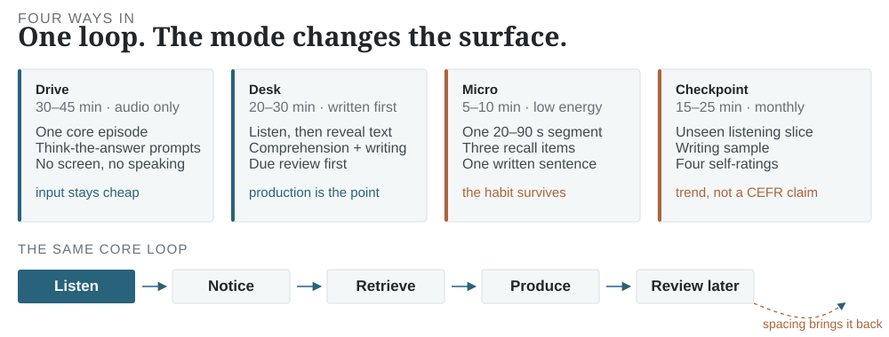
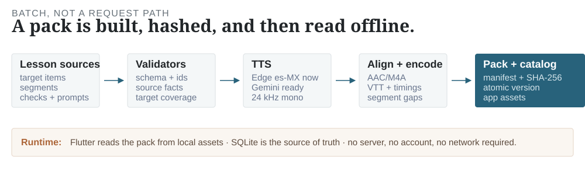

Most language apps are built to be returned to. This one is built to end.

The product is a daily Spanish session: a few due reviews, one leveled episode, a small comprehension check, one or two written answers, and a review date for what came back wrong. Then it stops. There is no feed to scroll, no energy meter to refill, no league table waiting at midnight. The design bet is that a session with a clear end is easier to trust — and easier to keep doing — than a surface engineered to maximize time inside it.

This entry is about the app we are building for one learner, and the parts that generalize: the learning loop, the local model, the content pipeline, and the lines we are refusing to cross. It is a working system, not a finished product. The repository is private while it is still a personal tool; the interesting parts are described here.

<figure class="ix" id="ix-loop" data-ix="loop">
  
  <figcaption>Fig 1. <strong>Four ways into the same loop.</strong> The mode changes the surface and the time budget, not the learning mechanism. Toggle a mode to see its session shape; without JavaScript the static diagram carries the same four modes.</figcaption>
</figure>

## The session is the product

The contrast is easiest to see as a design choice, not a moral one:

  

    <h4>Engagement-first surface</h4>
    
Streaks, hearts, leagues, timed boosts, an endless lesson path. Success is measured by return visits and time in app. The learning loop may be good, but the product optimizes for the loop being hard to leave.

  

  

    <h4>Learning-first surface</h4>
    
One finite session, a transcript that starts hidden, production that is actually required, and an honest end state. Success is measured by what survives a delay: comprehension of unseen audio, a written answer, a spoken minute.

  

That is a contrast in incentives, not a claim that every streaks-and-hearts app teaches nothing. Duolingo is very good at getting a learner to open the app. The question here was different: what would an app look like if the target were the learner needing it less — if the daily loop were designed to produce a person who can understand and answer, rather than a person who maintains a number?

The answer is not a feature list. It is a shape: short input, active retrieval, production, spacing, and a checkpoint that can contradict the story. The app should be willing to say “you have not improved on this measure yet.”

## One loop, four modes

The core loop is the same in every mode: **listen → notice → retrieve → produce → review later**. What changes is the surface and the budget.

- **Drive (30–45 min, audio only).** One core episode, screen locked, no taps. Embedded “think the answer” prompts with pauses, no speaking exercises. After parking, an optional thirty-second recall. The point is not to turn a commute into a classroom; it is to make input cheap enough to happen at all.
- **Desk (20–30 min, written first).** Up to eight due review items, one episode with the transcript hidden, comprehension questions, then one or two written production prompts. Writing is the default production mode, not a consolation prize. The session is saved with the actual listening time and the exercise ids that were attempted.
- **Micro (5–10 min, low energy).** One 20–90 second segment, up to three recall items, and one written sentence. Playback stops at the segment boundary. A micro session is recorded as a micro session, and it does **not** mark the whole lesson complete. A tired evening is a smaller session, not a broken streak.
- **Checkpoint (15–25 min, monthly).** An uncompleted or least-recently studied episode, a listening slice, comprehension, a level-appropriate writing sample, and four self-ratings: task completion, grammar, vocabulary, coherence. It is stored as an assessment session and it does not complete the lesson. It is explicitly a practice checkpoint, not a CEFR test.[^checkpoint]

The mode switcher above is the argument in miniature. Drive protects the habit. Desk protects the depth. Micro protects the low-energy day. The checkpoint protects against the most comfortable lie in self-study: that time spent is the same thing as learning.

## The learner model is the memory

The app has no account and no server. The learner model is a local SQLite database, and the model is built around a few rules that are easy to state and hard to keep:

- **Attempts are append-only facts.** An answer is never edited. A correction is a new attempt. The attempt carries the exercise, lesson, target items, response type, latency, hints, confidence, score, and — for written prompts — the learner's actual text.
- **Review and skill state are derived.** FSRS-6 schedules items[^fsrs]; Beta/Elo rows estimate concept strength with credible intervals; error tags accumulate examples. These are caches that can be rebuilt, not the history.
- **Sessions are separate from attempts.** A session records what the learner actually did: desk, drive, micro, or assessment, with planned and actual minutes, lesson ids, exercise ids, and the device.
- **The app exports and deletes.** The local JSON snapshot can be copied to the clipboard; deleting learner data removes attempts, reviews, sessions, and progress. There is no hidden copy in a cloud account.

What one answer writes

An answer appends an <code>AttemptRecord</code>, then updates the derived review and skill rows in the same local transaction. A written answer also stores the response text, so the checkpoint and review history can be inspected later. If the database is unreadable, startup quarantines it as <code>learner.db.corrupt-&lt;timestamp&gt;</code> and retries with a fresh store rather than showing a blank window forever.

The display is deliberately modest. Progress shows due items, next due time, evidence bands, the last seven days by session kind, error patterns, and per-concept estimates with 95% intervals. It does not show XP, a streak, or a “fluency score.” A number that cannot be explained is a number that will be gamed.

## The content factory

The app is a client for content packs. A pack is built by a batch pipeline, validated, hashed, and then read from local assets. At runtime the client never calls a model or a TTS service.

<figure class="hero-figure fig-keep">
  
  <figcaption>Fig 2. <strong>The factory is batch; the app is offline.</strong> Sources are validated for schema, ids, target coverage, and source facts. The current packs use Edge <code>es-MX-DaliaNeural</code> audio; a Gemini 3.8 Flash/Flash-Lite provider is implemented and waits on an API project with the Generative Language API enabled. The pack carries AAC audio, VTT transcripts, segment timings, a manifest, and file hashes.</figcaption>
</figure>

The source of truth is a directory of lesson JSON files. Each lesson has five to eight target items, at least three segments, one or more comprehension checks, and one or more production prompts. The builder assigns target items to segments by surface matching, synthesizes each segment, concatenates with a short gap, encodes AAC, writes VTT and timings, computes SHA-256 hashes, and writes a catalog.

The pipeline is deliberately boring in the places that matter:

- **Validators run before models.** Target items must exist, choices must be answerable, production prompts must include their required phrases, and news-shaped content needs source references.
- **The provider is a seam.** `espeak` is the offline placeholder; Azure, Google, Gemini, Edge, and Chatterbox sit behind the same interface. Gemini's Interactions API gets natural-language style metadata; a non-default rate becomes an advisory style hint, not a fake numeric control.
- **Retries are bounded.** Transient 429/5xx responses are retried with exponential backoff and `Retry-After`; authentication and disabled-API errors fail immediately instead of burning quota.
- **The pack is immutable.** A version never changes after publish. A fix is a new version. The pipeline writes a manifest and per-file SHA-256 hashes; the current bundled-asset loader checks catalog/manifest identity, and publish-time hash verification is still a contract to wire, not a finished claim.

The first packs use Microsoft Edge's consumer `es-MX-DaliaNeural` endpoint. It is free and it made real Spanish audio possible immediately, but it is **evaluation/personal use**, not a licensed production backend. Gemini Flash/Flash-Lite is the intended production voice; the provider is written and tested against mocked responses, but the current key's project has the API disabled,[^gemini] so the app still ships Edge audio. That is the honest state of the content path.

The content itself is still small. Nine lessons, three packs, 57.6 minutes of audio.[^content] That is enough to exercise the loop and the app; it is nowhere near the 20–40 hours a daily learner needs for months. The next constraint is not more app surface. It is more reviewed content.

## What it refuses to do

The non-goals are part of the design:

| Not building | Why |
| --- | --- |
| Hearts, energy, leagues, loss-framed streaks | They optimize return behavior, not learning. A low-energy day should shrink the session, not punish the learner. |
| An infinite feed or lesson path | The session has an end. The app should be leaveable. |
| A “fluency score” or precise CEFR claim | The evidence does not support one. Report ranges, evidence counts, and what was actually measured. |
| Pronunciation grading without calibration | ASR and LLM scores are not validated raters. Speaking feedback comes after a human calibration study, not before. |
| A server in the playback path | A downloaded lesson, an attempt, and a review must work with every server down. |
| Auto-published news | Licensing and factuality are not solved by a pipeline that can generate text. |
| A shared model key in the client | Any cloud call is user-supplied or proxied through a user-controlled endpoint. |

The app is not anti-gamification as a personality. It is against a gamification layer that makes the learning claim harder to check. A small amount of progress feedback is useful; a loss-framed streak that punishes rest is a different product.

## What is built, and what is not

The current spike is a Flutter app with a local SQLite learner model, three content packs, and a batch pipeline. The numbers below are from the repository at the time of writing:

  9 lessons
  3 offline packs
  57.6 min audio
  108 Flutter tests
  83 pipeline tests
  no native-listener review yet

  <table class="kv-table">
    <thead><tr><th>Check</th><th class="num">Result</th></tr></thead>
    <tbody>
      <tr><td>Flutter analyzer</td><td class="num">no issues</td></tr>
      <tr><td>Flutter tests</td><td class="num">108 pass</td></tr>
      <tr><td>Pipeline tests</td><td class="num">83 pass</td></tr>
      <tr><td>Pack validation</td><td class="num">3/3 packs</td></tr>
      <tr><td>Linux debug build</td><td class="num">built</td></tr>
      <tr><td>Headless launch</td><td class="num">clean start</td></tr>
      <tr><td>Bundled assets</td><td class="num">27 MB</td></tr>
      <tr><td>Audio decode</td><td class="num">9/9 M4A</td></tr>
    </tbody>
  </table>

What works end to end: pack loading from a catalog, background audio, transcript reveal and seek, the composed desk session, micro sessions, Drive Mode, due-first review, writing capture, FSRS-6 scheduling, progress evidence, a self-rated checkpoint, JSON export, learner-data deletion, and a light/dark theme. The app also survives a corrupt learner database by quarantining it and retrying.

What does not: placement, validated speaking assessment, native-listener review of the audio, word-level alignment, lexical-frequency coverage, sync, and a download/update control plane. The checkpoint is self-rated. The app is a personal tool, not a shipped product.

The verification is also part of the design. A green suite written by the same agent that wrote the code is not proof of learning. The app's tests prove the loop is wired, the persistence is durable, and the edge cases are handled. They do not prove that a learner improves. That requires delayed tests with real learners, which is the next measurement problem.

## What comes next

The next three bets, in order:

1. **Content scale.** The loop is only as useful as the next episode. The target is 20–40 hours of reviewed A1–B1 content, with a real review pass and a lexical coverage check. The pipeline can build it; the constraint is editorial time and TTS sign-off.
2. **Placement.** A short adaptive screener that chooses a starting level without a fake precision claim. It should report a range and an evidence count, then let the first two weeks correct it.
3. **Speaking.** Start with shadowing, read-aloud, and thirty-second voice notes. Add ASR only after a human calibration study; no phoneme-level scores before then. Speaking is a separate skill, and the app should not pretend that listening and writing transfer for free.

The Gemini path is ready when the API project is enabled. The content factory can switch providers without touching the app. The app can accept a new pack version without new loader logic because the catalog drives discovery; the pubspec still lists the active asset directories. Those are the seams that make the next round of work cheap.

The larger claim is simpler: a learning app should be judged by what a learner can do after the app is closed. This one is trying to make that sentence true, one finite session at a time.

## Sources

- **FSRS-6** — the open spaced-repetition scheduler used through the Dart `fsrs` package: [the algorithm](https://github.com/open-spaced-repetition/fsrs4anki/wiki/The-Algorithm), [package](https://pub.dev/packages/fsrs).
- **Retrieval practice** — Roediger & Karpicke (2006), *Test-enhanced learning: Taking memory tests improves long-term retention*, Psychological Science 17(3), [doi:10.1111/j.1467-9280.2006.01693.x](https://doi.org/10.1111/j.1467-9280.2006.01693.x).
- **Desirable difficulties** — Bjork & Bjork (2011), *Making things hard on yourself, but in a good way*, in *Psychology and the Real World*; the spacing and retrieval framing used here.
- **Flutter audio** — [`just_audio`](https://pub.dev/packages/just_audio), [`audio_session`](https://pub.dev/packages/audio_session), [`just_audio_background`](https://pub.dev/packages/just_audio_background), and [`media_kit`](https://github.com/media-kit/media-kit) for desktop.
- **Local data** — [SQLite](https://sqlite.org/) in WAL mode; the app's attempts are append-only rows and the derived tables are rebuilt from them.
- **Speech** — [Gemini speech generation](https://ai.google.dev/gemini-api/docs/speech-generation) for the production provider; Edge `es-MX-DaliaNeural` is used only as a free evaluation bridge.

[^fsrs]: FSRS-6 is the scheduler behind the due queue; the app disables interval fuzzing and injects the clock, so the scheduling tests are deterministic. Migrated rows with reps and a last-review timestamp keep their stability instead of resetting to a new card.
[^content]: The current packs are version `0.2.0`: three lessons per pack, 57.6 minutes total, 27 MB of bundled assets. The audio is real Edge Spanish, not espeak; the placeholder remains available for offline pipeline tests.
[^gemini]: The Gemini provider is implemented with `gemini-3.8-flash-tts` and `gemini-3.8-flash-lite-tts`, regional `es-419-podcaster-1/2` voices, and natural-language style metadata. A live call currently returns HTTP 403 because the key's Google Cloud project has the Generative Language API disabled; enabling it is a console action, not a code change.
[^checkpoint]: The checkpoint is a self-rating, not an external rater. It is useful for trend and habit; it is not evidence of CEFR level, and the app says so in the checkpoint screen.
