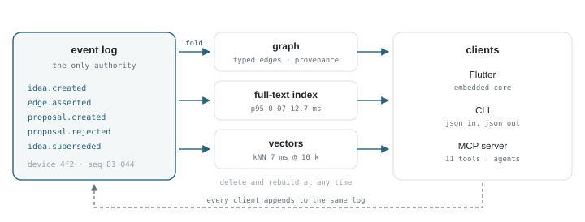
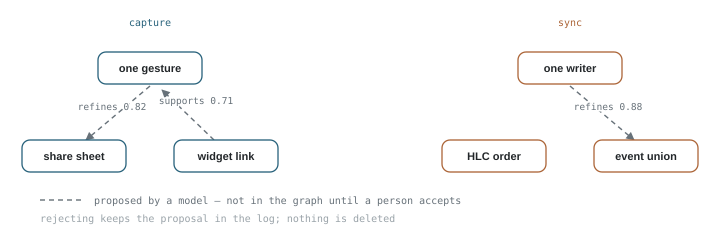

A note is a container for something you already know how to say. An idea is not that. It arrives half-formed, attached to nothing, and usually at the wrong moment — in a queue, on a walk, three seconds before sleep. Every tool we have optimizes the container: the page, the database, the block, the bullet. So the idea gets filed, or it gets lost, and either way the part that mattered — what it was *for* — stays in your head until it doesn't.

Idea Vault is an attempt to store the other thing. It is a repository where ideas are appended rather than filed, connected by a machine that has to explain itself, and retrieved by meaning as often as by words. It is not a note-taking app, and the first thing the research did was talk me out of several features it seemed obvious to build.

Nothing in this entry is shipped software. Phase 1 was a manifesto, seven research tracks, and two measurement spikes against synthetic vaults. The numbers below are real; the product is not, yet. What follows is the design that survived contact with the evidence.

## The note is the wrong unit

Three failures recur in every tool I looked at, and they are not the same failure.

**Capture friction.** Anything that takes more than a few seconds loses to the next thought. The most successful capture surface ever shipped is a single text field that returns you to what you were doing — org-capture, Workflowy, the Roam daily note. None of them ask for a title, a folder, or a tag, because a schema at 2 a.m. is a tax on having the idea.

**The write-only graveyard.** Capture without retrieval is a diary nobody rereads. Obsidian users are candid about this: in a 28,000-view forum thread, the global graph is called "a bunch of dots", "a hairball", and routinely switched off. What people defend is the *local* graph — one note, its neighbours, a depth slider. The thing everyone demos is the thing nobody opens twice.

**The structure tax.** You can have retrieval, but only by doing bibliographic labor you will not do: linking every note, choosing relation types, maintaining an index. Niklas Luhmann made it work with roughly 90,000 slips and some 50,000 references, but his method had a rule the software dropped — write *why* the link exists beside the link.[^luhmann] No mainstream tool exposes a rationale field on a relation. That absence is the most defensible thing in this design.

Automation is the only escape from the third failure, and it is not a free one. Rules move the tax into rule-authoring, which is why Tinderbox agents never became a mass tool. Silent autofill moves it into cleanup, which is why AI-filled Notion databases feel like chores. The narrower bet here is that **machine proposals are cheaper to reject than rules are to write** — and that bet is falsifiable, which is the point.

## Three representations, one substrate

The vault stores one thing and derives two.

<figure class="hero-figure">
  
  <figcaption>Fig 1. <strong>One authority, three faces.</strong> The log holds every idea, edge, proposal and review. The graph, the index and the vectors are projections: delete them, refold the log, get the same vault back.</figcaption>
</figure>

**Events are the truth.** Every creation, edit, link, proposal, acceptance and rejection is an append-only record with an actor, a timestamp, and a per-device hash chain. Nothing is updated in place and nothing is deleted — a superseded idea keeps both texts, and "what did I believe in March" is a replay, not a restore.

**The graph is a projection.** Typed, directed edges with attributes on the edge: `type`, `provenance`, `confidence`, `status`, `rationale`. This is the unglamorous choice, and it is the correct one: the property graph is what GQL standardised in ISO/IEC 39075:2024, and putting provenance *on the edge* is a column instead of a reification subgraph. N-ary relations exist — "this synthesises B and C because R" — but they are an escape hatch (an assertion node with role edges and no body), used rarely and hidden from every consumer.

**Vectors are a cache.** An embedding table keyed by `(model, dims, prompt, content_hash)`. A model swap writes a new generation and flips atomically, because the expensive part of re-embedding is not the tokens — it is every artifact derived from them.

The test of this architecture is blunt: delete all derived data, refold the log, compare hashes. On a synthetic vault of 100,000 events that takes **396 ms** and produces byte-identical projections. A million events fold in 5.4 s. That is why the log can be the truth without being a performance problem.

It is also what the prior art says, by counterexample. Roam's only data recovery in 2020 came from replaying its server-side transaction log. Logseq made Markdown files the truth and has been paying for it with a multi-year database rewrite and a product split. Notion needed until August 2025 to ship offline mode because its block model made it hard.

## Machines propose, humans promote

Every machine-written relation is a **proposal**, not an edge. It carries an actor (`agent:omp`, `extractor:bge-m3@1.2`), a confidence, a rationale, an expiry, and a status. It is visible in the graph as a dashed line — present but not believed. A human promotes it, and promotion is an event.

That single split does most of the work. It turns the review queue into the only path by which a model can change structure, which means the queue cannot be bypassed by a clever tool call, a retry, or a plugin with a bright idea.

<figure class="ix" id="ix-triage" data-ix="triage">
  
  <figcaption>Fig 2. <strong>Try the loop.</strong> Three machine proposals against a small vault. Accept one and the dashed line becomes a typed edge with a label; reject one and it leaves the graph but stays in the log. Watch the tally and the event strip. This is the entire mechanism: no model call happens here, and nothing is deleted.</figcaption>
</figure>

The policy is deliberately asymmetric, because a wrong `tangent` edge costs a glance while a wrong `contradicts` edge edits belief:

| Operation | Auto-promote | Rule |
| --- | --- | --- |
| `tangent`, `inspired_by` | yes | confidence ≥ 0.8, both endpoints exist, no duplicate |
| `refines`, `supports`, `contradicts`, `answers` | no | always queued for a human |
| `set_kind`, `unlink` | no | queued |
| `supersede`, `merge` | never | human only, with a precondition check |

There is no `delete` operation in the vocabulary. Not as a policy — as an absence.

## The graph is not the interface

If the graph were the interface, this project would fail for the same reason the others did. On a mid-range phone, a force-directed canvas is usable to roughly **300–500 labelled nodes** with hit-testing; 2,000–5,000 is the ceiling for unlabelled dots; 10,000 is a cluster map or a static image. Meanwhile 400 complex paths already pan at 10–20 fps on Android.

So the graph is a *query result*, never a destination:

- `neighbors(id, hops)` — the local graph, capped at a few hundred visible nodes.
- `path(a, b)` — the question a graph actually answers well, and the one no notes app lets you ask.
- `explain(edge)` — the why-chain, as a traversal rather than a string, so an agent can check it instead of paraphrasing it.
- clusters as a coarse map: dozens of circles, tap to expand into a neighbourhood.
- a timeline, because timestamps are free and "what was I thinking in March" is a query, not a browse.

The measurement that changed the implementation: depth-limited traversal is the wrong primitive. A 3-hop neighbourhood costs **3.5–137 ms** depending on density, and a shortest-path BFS at depth 5 costs **115 ms** — because cost tracks result-set size, not index misses. One personalized-PageRank pass over the whole graph, ranking and truncating, costs **13 ms** and returns a scored top-k. So traversal belongs in the application layer as a ranking problem, not in recursive SQL as a depth problem. Rank, don't truncate.

## What the numbers said

Everything here was measured on synthetic vaults sized to the design target — 10,000 ideas, 100,000 typed edges — on one machine, with SQLite 3.40 and numpy. These are the numbers that decided something.

| Operation | Measured | What it decided |
| --- | ---: | --- |
| FTS5 term search, top 50 | 0.07–12.7 ms p95 | lexical search is not the bottleneck; the UI is |
| 1-hop neighbours | 0.03 ms | neighbourhood views are free |
| 3-hop neighbourhood | 3.5–137 ms | depth is a ranking problem, not a query |
| shortest path, depth ≤ 5 | 115 ms | bidirectional, or a hard depth cap of 4 |
| personalized PageRank, whole graph | 13 ms | ranked traversal replaces truncation |
| cosine kNN, 10 k × 768 | 7 ms | no vector database at this scale |
| fold 100 k events → projections | 396 ms | the log can be the source of truth |
| full vault file, 10 k / 100 k | 12–24 MB | one portable artifact is viable |

  search: 3 orders of margin
  traversal: rank, don't truncate
  vectors: brute force wins
  no ANN needed

Two of these were surprises. Brute-force cosine at 10,000 vectors is faster than the IPC hop to a native index, and `sqlite-vss` — the obvious choice — is abandoned; its successor `sqlite-vec` is pre-1.0, brute-force, and misses the latency budget at 100,000. Vectors are stored as plain blobs in the same file and the "index" is disposable.

The other surprise was how cheap the log is. Event sourcing gets a reputation for complexity, and the replay cost that earns it does not exist at personal scale. The real cost is projection *correctness* — ordering, idempotency, and late events — which is a testable property, not an architectural gamble.

## The model is a worker

The two obvious AI features are the two the evidence rejected.

**LLM-built knowledge graphs.** Microsoft's own numbers put GraphRAG indexing at **$3.29 for a 38,000-token document**, with users reporting $35 for ten documents. Independent evaluation found LLM-built graphs cover about **65.8%** of the answer entities, and triplet-only retrieval scored **F1 34.28 against 64.78** for plain chunk retrieval. Microsoft's successor pipeline gets to 0.1% of the indexing cost by *not* using an LLM to extract the graph. Extracting structure from your own prose with a model is the expensive way to get a worse graph than the one your own links already describe.

**Auto-ideation.** This is where the research is genuinely interesting. In a 2024 blind study, expert reviewers rated LLM-generated research ideas *more novel* than human ones (5.64 vs 4.84, p<0.01), with no significant feasibility deficit. In the 2025 follow-up, 43 experts actually *executed* a subset of those ideas for over a hundred hours. The LLM ideas' scores dropped significantly more on every metric, and the rankings flipped. Novelty at reading time is not quality; it is the thing models are best at faking.

So the success criterion changed. It is no longer "30% rated worth exploring". It is **"would I spend a day executing this?"**, blind, against a random-pair control, with every rating logged. And the generator is capped at ten proposals a week, because a thousand seeds produced about **5% non-duplicates** at cosine 0.8 — volume buys a queue you stop reading.

What remains is the unglamorous middle: embeddings for recall (local, ~15 MB for 10,000 ideas), one adjudication call per candidate pair to decide whether a proposed edge is real, and a synthesis call that is allowed to propose at most ten candidates that then go through the same queue as everything else. The whole ML layer costs **$1–6 a month** at this volume. Money is not the constraint. Attention is.

## One file, one writer, one Pi

Each device owns its own vault and its own append-only log. Sync is the union of those logs, ordered by a hybrid logical clock, with idempotency keys so a retry cannot duplicate a capture. There is no merge protocol because the event set only grows.

That is not a simplification of a CRDT — it is a rejection of one. Yjs replayed a 105,000-character benchmark in 5.7 s; at a hundred times that size it took 609 s and 327 MB. Immutable per-event text removes the hard half of the problem: there is no concurrent keystroke editing to merge, only independent facts to union. AT Protocol already does this in production at account scale, with one writer per repository and a monotonic revision.

The artifact is a single SQLite file, never inside a sync folder — SQLite's own documentation says WAL does not work over network filesystems, and Syncthing's maintainers are blunt that bidirectional SQLite sync "will break spectacularly". Snapshots come from `VACUUM INTO`, not `cp`.

There is one always-on machine: a Raspberry Pi 5, about **3 W idle** and roughly **$145** once, which holds a full copy, stores everyone's log segments, hosts the agent endpoint, and runs enrichment overnight. It is a peer, not an authority. Take it offline for a week and capture, search and review keep working on every client.

The two operational decisions that matter are boring. Boot from NVMe, not an SD card — the failure mode is not wear, it is silent corruption that takes the OS and the vault together. And make enrichment a queue with a per-run token budget and a monthly cap that fails closed, because the only genuinely scary failure in this architecture is not a dead Raspberry Pi. It is a runaway agent loop on a metered API.

## What it refuses to do

It is not a note-taking app. Obsidian already won that, and Markdown is an export format here, never the write path. It is not a task manager, a chat app with memory, or a hosted service.

It will not ship a global graph canvas as the product. It will not let a model write an edge without a human or a narrow policy promoting it, and it will never auto-promote `supersedes` or `merge`. It will not run LLM entity extraction over your prose. It will not adopt bitemporality, or a hypergraph core, or graph embeddings that need retraining on every write. Each of those is defensible in isolation and none of them paid for itself when measured.

And it will not generate ideas until the review loop works. That is the ordering that matters: capture, recall, triage — then, if the rating log says the proposals are worth reading, generation.

Phase 1 closed with a manifesto, seven research tracks, two spikes and a roadmap with gates. The first gate is unglamorous: capture an idea on a Raspberry Pi, kill the power, reboot, and prove the vault comes back byte-identical. If that does not hold, none of the rest is worth building.

The vault is not where ideas go to be stored. It is where they go to be argued with.

[^luhmann]: Johannes Schmidt, "Niklas Luhmann's Card Index: The Fabrication of Serendipity", *Sociologica* 12(1), 2018 — roughly 90,000 slips, about 20,000 references in the first collection and 30,000 in the second, all linked positionally rather than semantically, and an access route through a keyword index rather than through link types.
