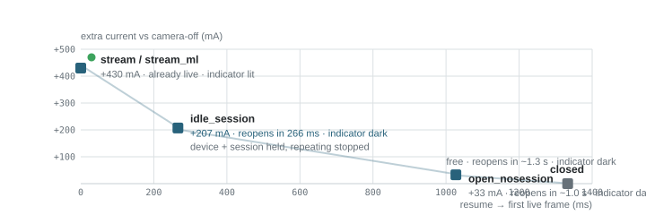

The [previous write-up](../the-camera-was-never-slow/) fixed a blank second by keeping one camera warm for the app's lifetime. Warm, it turned out, is a fine thing for a camera to be: prewarmed entry paints a frame in 1–20 ms, and the NFC handoff costs a fifth of a second instead of a second and a half. But a scanner that stays ready through a shift is a camera that stays *on* through a shift, and "on" is not one state. Between "streaming live preview" and "fully released" sit several cheaper ways to hold a camera — and nobody had priced them. This entry prices them: milliamps, reopen milliseconds, and what the privacy indicator shows while the app waits between reads.

<figure class="hero-figure">
  
  <figcaption>Fig 1. <strong>The ladder of ready states.</strong> Each square is a measured steady state of the same camera pipeline on a Galaxy S24 FE: added current along the vertical axis (vs the app sitting with the camera off), reopen time along the horizontal. The frontier is clear — the first ~200 mA buys almost all of the latency; the last ~230 mA buys "already live". Green dot = camera privacy indicator lit.</figcaption>
</figure>

## The short version

- A live preview costs **~430 mA over camera-off** (−600 mA total with screen and WiFi on). A session held open with repeating *stopped* costs **207 mA** (−372 total). A device held open with no session costs **33 mA**; fully closed is the baseline.
- The stopped session **reopens in 266 ms** on a hot phone and ~270 ms on a cold one — steady. The open device without a session buys ~1.0 s reopen for its extra 33 mA; fully closed costs ~1.3 s hot. Cold phone, those reopens are 658 ms and 936 ms.
- The Android **privacy indicator tracks frames, not handles**: it is dark in the stopped-session state — the preview shows a frozen last frame — and lit only while frames actually flow.
- On this device, **ML Kit inferencing on top of a streaming preview is free within noise** (Δ ≈ 7 mA in an interleaved rerun). The pipeline, not the decoder, is the bill.
- Run the math and **an always-streaming scanner cannot finish a nine-hour shift on one charge** (~8 h to empty). Holding the stopped session between scans is ~13 h. Dropping to camera-off between bursts costs reopen time only when the next scan actually comes.
- The trick needs `stopRepeating`, which **CameraX does not expose** — the reference implementation is a raw `camera2` engine. The [P4 skeleton](../the-camera-was-never-slow/) from the first campaign, extended with a mode machine, is the vehicle.

## The bill for staying ready

One correction to the mental model first, because it changes where the money goes: none of the six benchmark apps in the first campaign keep the camera running *on the NFC screen*. All of them release the camera before the reader starts — that serialization is the product's arbiter, and it was never broken. The camera-alive stretch is the **rest of the session**: launch prewarm, the search tab, and the scan tab sitting idle between reads. For someone working a queue of customers, that is not a 30-second burst; it is the whole shift, with a read every few seconds to a few minutes. The first write-up optimized the moments the camera turns on. This one is about the hours in between, when the app is "ready" — and what ready should mean.

## Five ways to hold a camera

We built **p5_idle** — a copy of the P4 app (raw `camera2` + ML Kit, the emulator-campaign skeleton) with the lifecycle replaced by a mode machine. It shares one preview texture and one optional ML Kit analyzer across all modes, and every transition runs through one idempotent `driveTo()`:[^p5]

| mode | device | session | repeating | ML Kit |
| --- | --- | --- | --- | --- |
| `closed` | closed | closed | no | no |
| `open_nosession` | **open** | closed | no | no |
| `idle_session` | **open** | **open** | **stopped** (`stopRepeating` + `abortCaptures`) | no |
| `stream` | open | open | preview | no |
| `stream_ml` | open | open | preview + analysis | yes |

Resume latency is measured from the broadcast command to the first `onCaptureStarted` frame. The important state is `idle_session`: the camera device and session stay open, but no repeating request is submitted, so the sensor stops sending frames and the OS stops counting the camera as "in use" even though nothing was torn down.

Why raw `camera2`: CameraX manages repeating requests internally and exposes no `stopRepeating` equivalent, so a CameraX pipeline cannot park in this state at all. `stopRepeating` + a live session is a `camera2` primitive.

Measurement, briefly:[^method] the phone (SM-S721B, Galaxy S24 FE, 4700 mAh, Android 16) spent the entire run **unplugged**, reached over wireless adb from the host so no cable current could contaminate the numbers; the app sampled `BatteryManager.BATTERY_PROPERTY_CURRENT_NOW` and the charge counter every 5 s into a CSV on device storage. The power run cycled nine 80-second windows — `closed, stream, closed, stream_ml, closed, idle_session, closed, open_nosession, closed` — with the closed windows interleaved so thermal drift could be interpolated out rather than assumed away. Screen brightness was pinned, WiFi on, no SIM.

## What each state costs

Unplugged, mean of 15 samples per window (first transition sample dropped), plus the interpolated `closed` baseline at the same point in time:

| state | mean current | Δ vs camera-off | extra vs camera-off |
| --- | ---: | ---: | ---: |
| `closed` (steady) | −165 mA | — | — |
| `open_nosession` | −197 mA | −33 mA | +33 mA |
| `idle_session` | −372 mA | −207 mA | +207 mA |
| `stream` | −599 mA | −434 mA | +434 mA |
| `stream_ml` | −595 mA | −430 mA | +430 mA |

Three findings beyond the table:

- **ML Kit is free on top of streaming here.** The two streaming windows landed within 4 mA of each other, and an interleaved rerun (stream vs stream_ml, twice, 45 s windows) put them 7 mA apart. Once the ISP is pushing 1280×720 frames at 30 fps, backpressured barcode inference at a few frames per second is in the noise on this SoC.[^ml] On weaker silicon, expect the decoder to matter.
- **The heat outlives the camera.** The first `closed` window right after streaming averaged −281 mA against a −165 mA steady baseline — thermal soak burning ~70 % extra for minutes after the preview is gone. Any honest battery model of "stream occasionally" needs this: the cost of camera use extends past the release.
- **An open device with no session is nearly free.** +33 mA holds the HAL client and the warm device without a capture pipeline. It is the cheapest "keep the door open" state — one that playbooks for camera-heavy apps rarely mention.

## What each state buys

Resume-from-hold latency, single cold runs (n=1, cool phone) and an n=8 battery right after the power run ("hot" = phone has been streaming for ~25 minutes):

| from state | cold | hot (median, range) |
| --- | ---: | ---: |
| `idle_session` | 280 ms | **266 ms** (250–295) |
| `open_nosession` | 658 ms | **1027 ms** (1003–1067) |
| `closed` | 936 ms | **1333 ms** (1294–1688) |

The breakdown of a hot reopen is where the surprise lives: `open_nosession` spends **795 ms in `createCaptureSession`** (392 ms cold) and 240 ms to first frame. Fully `closed` pays only 56 ms to open the device and 272 ms to configure — then **1819 ms for the first frame after `setRepeatingRequest`**, against 578 ms cold. Sensor and pipeline warm-up dominate, and it degrades with temperature.[^hot] The consequence: the states that look fast on a cold lab phone get 30–100 % slower on a phone that has actually been working — exactly the phone in the scenario.

`idle_session` is the exception: 266 ms hot, 280 ms cold, and 149–283 ms even after a **ten-minute hold** — during which the OS never force-closed the idle device (the camera service still listed the app's client when we checked `dumpsys media.camera` after the hold).[^hold] One caveat: the first resume right after entering `idle_session` from a cold open cost 961 ms once; that is the open-and-configure tail of the entering transition, and every subsequent resume from the held state was ~260 ms.

## The dot

The product question the first write-up left open — "prewarming lights the camera indicator on launch; is that acceptable?" — turned out to have a better answer than any of the options listed there. We cycled the phone through all five states, watching the green privacy dot:

| state | indicator |
| --- | --- |
| `stream` / `stream_ml` | **lit** |
| `idle_session` | **dark** |
| `open_nosession` | **dark** |
| `closed` | **dark** |

The Android indicator tracks *frames actually flowing*, not an open device handle. After `stopRepeating` + `abortCaptures`, the dot goes dark while the device and session stay open — the screen shows the last frozen frame[^frozen] and no new pixels leave the sensor as far as the OS is concerned. So there is a state that is **fast (266 ms), dark (no lit dot, nothing visibly live), and cheaper than streaming by half**. For someone standing in front of customers, "the app looks idle and the indicator is off" is not a compromise version of privacy — it is most of what the fully-closed state offers, at a seventh of the reopen cost.

## A shift on one charge

Steady state, %/h of the 4700 mAh battery, camera state only (screen and WiFi are in every row and cancel in the deltas; 9 h = a generous shift; `100 %` is empty):[^wifi]

<figure class="fig-keep">
  

  

    
closed29 h to empty31 % / 9 h

    

      

      

    

    
finishes the shift with ~69 % left

  

  

    
idle_session13 h to empty71 % / 9 h

    

      

      

    

    
finishes the shift with ~29 % left

  

  

    
stream / stream_ml~8 h to empty115 % / 9 h

    

      

      

    

    
dead ~1 h before the shift ends

  

  

    <i class="sw is-camera"></i>camera off between scans
    <i class="sw is-stack"></i>session held, repeating stopped
    <i class="sw is-wait"></i>preview streaming all shift
  

  

  <figcaption>Fig 2. <strong>Scaling the measured states to a shift.</strong> Bars are the measured %/h times 9 h, drawn to a common 120 %-scale. The always-streaming app dies before the shift does; the stopped-session app finishes with charge to spare. Extrapolation from ~12-minute windows — the <em>deltas</em> are the measurements, the shift-length arithmetic is the projection.</figcaption>
</figure>

The policy that falls out of the numbers, in order of conviction:

1. **Never idle-stream.** Preview streaming is 2× the stopped-session power, ~230 mA more than `open_nosession`, and it is the only idle state that lights the indicator in front of customers. When reads are sparse it buys nothing the stopped session doesn't.
2. **During a scan burst, hold `idle_session` between reads.** 266 ms resumes, dark indicator, half the power of streaming. Marginal cost of holding the session over holding just the device: 174 mA for ~760 ms saved per resume; if the next person's card is seconds away, that's the right trade — if it's ten minutes away, it isn't.
3. **Step down when the burst dies.** `idle_session → open_nosession` (saves 174 mA, costs ~760 ms at next resume) → `closed` (saves the last 33 mA, costs ~300 ms more). A simple timer ladder — seconds in session, minutes in open, else closed — tracks the queue's rhythm without a server.
4. **Close immediately on screen-off, background, or handoff.** A held device is also a device other apps' camera calls queue behind.
5. **Budget for heat, not just state.** Soak extends the camera's cost past the release, and it slows every reopen except the stopped session's. The held-session state is the only one whose latency didn't care how long the phone had been working.

The implementation catch, stated once: this needs `stopRepeating`, so it needs a raw `camera2` engine — `p5_idle` is one, ~700 lines on the P4 skeleton, with the mode machine replacing the lifecycle. CameraX-based apps can keep the prewarm-and-release architecture from the first campaign unchanged; they just can't park in the cheap-dark state without an escape hatch to `camera2`. The design paper for the package that would package this up — `instant_barcode_scanner` — is [Instant by Design](../instant-by-design/).

  stopped session: 266 ms, dot dark
  streaming: +430 mA, dot lit
  always-streaming dies mid-shift
  CameraX cannot stopRepeating

## The data

Raw traces ship with this site: the [nine-window unplugged power run](../data/power/power_unplugged_9x80s.csv), the [interleaved ML check](../data/power/power_ml_interleaved_4x45s.csv), the [n=8 latency battery](../data/power/latency_hot_n8.csv), and the [ten-minute hold run](../data/power/hold_run.txt) with its [logcat](../data/power/hold_logcat.txt) and [camera-service extract](../data/power/media_camera_hold_extract.txt) — every window, every outlier, nothing smoothed; the method is footnoted above. The startup-latency dataset from the first campaign is still browsable at the [dataset browser](../data/), and the `p5_idle` sources stay in the private benchmark repository for now.

## Sources

Every claim above is a platform contract or a measured trace; these are the contracts.

- **`BatteryManager`** — [`BATTERY_PROPERTY_CURRENT_NOW`](https://developer.android.com/reference/android/os/BatteryManager) and the charge counter are the sampling source; the [battery monitoring guide](https://developer.android.com/training/monitoring-device-state/battery-monitoring) covers the API surface. (Current sign follows the device's gauge: negative = discharging.)
- **`camera2` session control** — [`CameraCaptureSession#stopRepeating()`](https://developer.android.com/reference/android/hardware/camera2/CameraCaptureSession#stopRepeating()) and [`#abortCaptures()`](https://developer.android.com/reference/android/hardware/camera2/CameraCaptureSession#abortCaptures()) are the idle-hold primitive; the [device](https://developer.android.com/reference/android/hardware/camera2/CameraDevice) stays open across them.
- **Camera arbitration** — [`CameraManager.AvailabilityCallback`](https://developer.android.com/reference/android/hardware/camera2/CameraManager.AvailabilityCallback) remains the truth source for "the camera is actually free", as in the first campaign.
- **Privacy indicators** — the OS indicator behavior is documented with the [Android 12 privacy features](https://developer.android.com/about/versions/12/features#privacy-indicators); our observation (frames, not handles) is the measured refinement.

[^p5]: `p5_idle` — a copy of the P4 app with `MainActivity.kt` replaced by a mode machine (`driveTo()` converging to a target of device × session × streaming × ML) plus a broadcast control surface (`SET_MODE`, `RESUME`, `POWER_TEST`) used by the bench scripts. All transitions are idempotent; the analyzer is arity-gated the way P4's is.
[^method]: Power windows: 80 s each, sample every 5 s, first sample of each window dropped (transition bleed), n=15 per window. Closed-window interpolation: the two nearest `closed` means bracket a camera window and the baseline is linearly interpolated at the camera window's position in the sequence. Brightness pinned at 120/255, `low_power` off, WiFi on, SIM absent, phone unplugged, adb over TCP so no charging current flows. The streaming state measured is the camera2 pipeline (p5_idle's P4 ancestry); the CameraX flavors of P1/P3 may have a different constant — the state deltas, which is what the ladder is made of, are engine-independent as long as the engine can stop repeating.
[^ml]: Interleaved check: `stream, stream_ml, stream, stream_ml`, 45 s windows, same unplugged conditions, means −578 mA vs −585 mA. Difference ≈ 7 mA, below the run-to-run spread of the gauge.
[^hot]: "Hot" = immediately after the 13-minute power run, ambient ~25 °C, phone warm to the touch. The spread matters: `closed` ranged 1294–1688 ms across 8 reps, `open_nosession` was tight at 1003–1067 ms, `idle_session` 250–295 ms (excluding the one cold-entry resume at 961 ms).
[^hold]: Ten minutes in `idle_session`, screen on, overlay visible. `dumpsys media.camera` before and after still lists `com.cardscanner.p5_idle` as the active client on Camera ID 0 — no force-close, no binder death. Post-hold resumes: 149 / 281 / 283 ms.
[^frozen]: The same frozen-frame behavior the first campaign documented for texture rebinds: the persistent texture repaints its last frame instantly, which is why nothing looks broken while the sensor is quiet. The difference here is intentional and free — the last frame sits there for as long as the hold lasts.
[^wifi]: Absolute currents include the screen at the pinned brightness, WiFi, and the Flutter app itself; the portable numbers are the deltas. %/h = |mean mA| ÷ 47 for this 4700 mAh device; a different phone shifts the constant, not the ordering.
